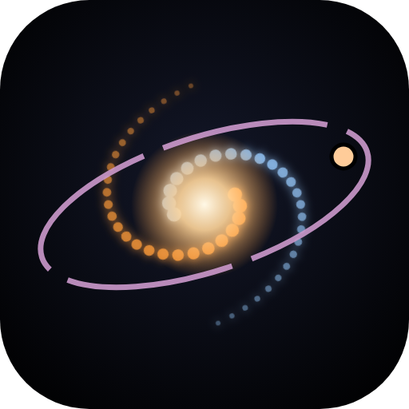
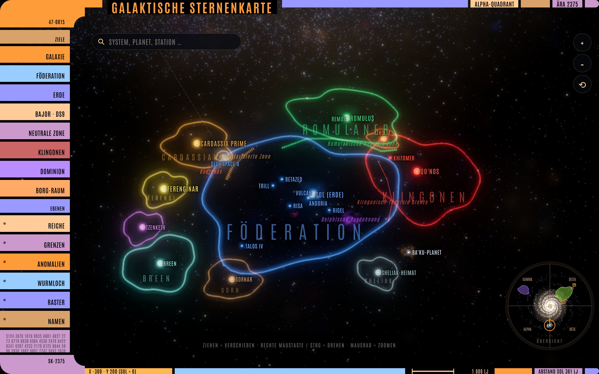
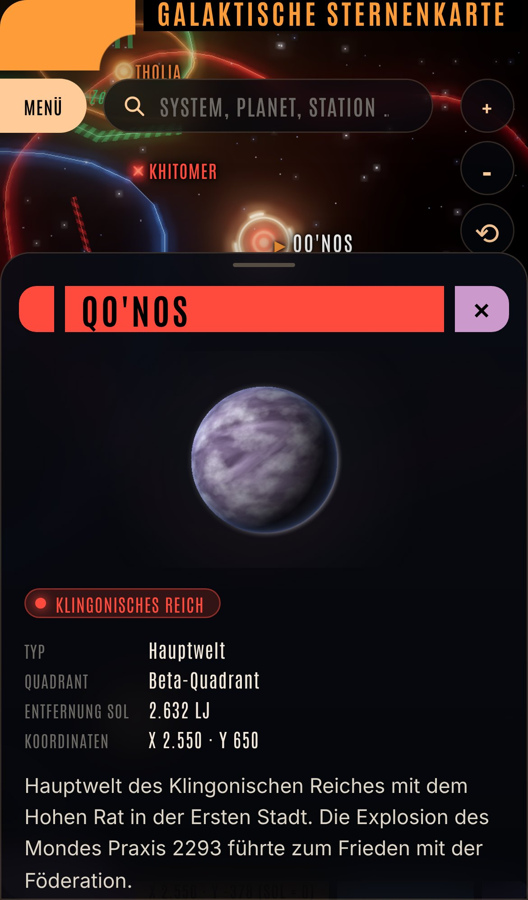
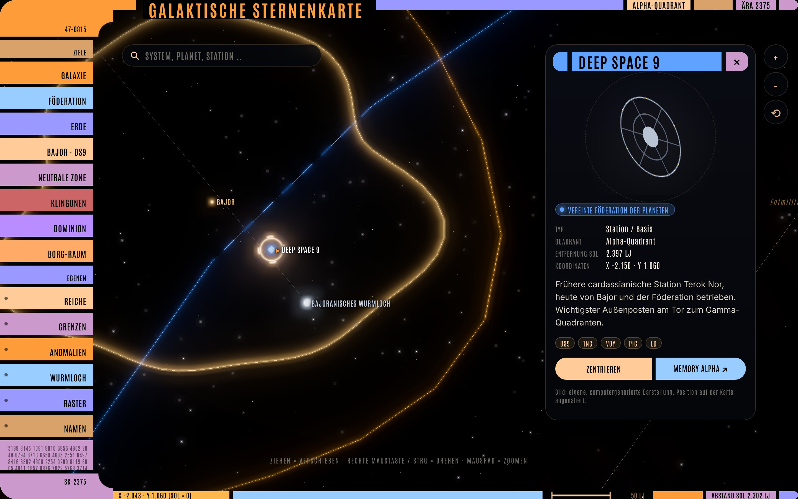

<div align="center">



# Galaktische Sternenkarte

**Die Milchstraße des Star-Trek-Universums als interaktive 3D-Karte.**
Quadranten, Großmächte, Grenzen und Schauplätze aus allen Serien und Filmen – zum Drehen, Zoomen und Nachschlagen.

[](https://jannickspielt.github.io/Star-Trek-Intergalactic-Map/)
[](https://threejs.org)
[](#als-app-installieren)
[](LICENSE)

<br>


</div>

---

## Was die Karte kann

| | |
|---|---|
| 🌌 **Echte 3D-Galaxie** | Rund 300.000 Sterne in vier Spiralarmen mit Balken, Staubbändern und Nebelleuchten. Frei drehen, kippen und zoomen – von der ganzen Milchstraße bis zu den Nachbarsternen der Erde. |
| 🛡️ **Großmächte & Grenzen** | Föderation, Klingonen, Romulaner, Cardassianer, Dominion, Borg und 14 weitere Reiche. Dazu die Romulanische Neutrale Zone, die Entmilitarisierte Zone und die klingonische Grenze. |
| 🪐 **70 Schauplätze** | Jeder Ort hat einen kurzen Text, seine Serien und Filme, Quadrant, Entfernung zur Erde und ein eigenes, im Browser berechnetes Planetenbild. Mit Link zu Memory Alpha. |
| 🌀 **Anomalien** | Badlands, Mutara-Nebel, Delphische Ausdehnung, Briar Patch, die Große Barriere im Kern, die Galaktische Barriere am Rand und das Bajoranische Wurmloch als leuchtender Bogen bis in den Gamma-Quadranten. |
| 🔎 **Suche** | Findet auch andere Schreibweisen: „Kronos“ führt nach Qo'noS, „Terok Nor“ zu Deep Space 9. |
| 🧭 **Navigation** | Schnellziele in der Seitenleiste, Übersichtskarte, Ebenen zum Ein- und Ausblenden, Maßstab und Koordinaten in der Statuszeile. |
| 📱 **Handy & PC** | Ziehen, Pinch-Zoom und Drehen mit zwei Fingern. Am Handy öffnet sich das Infofenster von unten. |
| ⬇️ **Als App** | Installierbar auf Startbildschirm oder Desktop und nach dem ersten Besuch auch offline nutzbar. |

<table>
<tr>
<td width="62%"></td>
<td width="38%"></td>
</tr>
<tr>
<td></td>
<td></td>
</tr>
</table>

## Bedienung

| Aktion | Maus | Touch |
|---|---|---|
| Verschieben | Linke Maustaste ziehen | Ein Finger ziehen |
| Zoomen | Mausrad, Doppelklick, `+` / `−` | Zwei Finger auseinander / zusammen |
| Drehen & kippen | Rechte Maustaste ziehen (oder `Strg` + ziehen) | Zwei Finger drehen / gemeinsam hoch und runter |
| Ort auswählen | Klick auf Markierung | Antippen |
| Suchen | `/` drücken oder ins Suchfeld klicken | Suchfeld antippen |
| Auswahl schließen | `Esc` | Infofenster nach unten wischen |

## Lokal starten

Die Karte ist eine reine statische Webseite ohne Build-Schritt. Wegen der JavaScript-Module braucht sie aber einen kleinen lokalen Webserver:

```bash
npm run serve
```

Danach <http://localhost:8080> öffnen. Ohne npm geht es genauso mit `python3 -m http.server 8080`.

## Auf GitHub Pages veröffentlichen

1. Im Repository **Settings → Pages** öffnen.
2. Bei *Source* **Deploy from a branch** wählen, den Branch und den Ordner `/ (root)` auswählen.
3. Speichern. Nach etwa einer Minute ist die Karte unter `https://<benutzername>.github.io/Star-Trek-Intergalactic-Map/` erreichbar.

## Als App installieren

- **Android / Chrome:** Menü ⋮ → *App installieren*
- **iPhone / Safari:** Teilen → *Zum Home-Bildschirm*
- **Desktop / Chrome & Edge:** Installieren-Symbol rechts in der Adressleiste

## Projektaufbau

```
index.html            Seitengerüst, Import-Map für three.js
css/style.css         gesamte Gestaltung (LCARS-inspiriert)
js/data/              Orte, Reiche, Regionen, Grenzen, Schnellziele
js/core/              reine Logik: Koordinaten, Suche, Beschriftung, Kamera
js/render/            3D: Galaxie, Reiche & Anomalien, Marker, Planetenbilder
js/ui/                Oberfläche: Rahmen, Infofenster, Suche, Übersichtskarte, Intro
icons/                App-Logo und Icons
sw.js                 Service Worker für Offline-Betrieb
tests/                Unit-Tests (node:test) und Browser-Tests (Playwright)
```

Neue Orte kommen in `js/data/places.js`. Jeder Eintrag braucht Position, Fraktion, Typ, eine Wichtigkeit von 1 bis 4, einen Kurztext, die Serien und einen Bildstil. Die Tests prüfen, ob alles vollständig ist.

## Tests

```bash
npm test        # Logik und Daten
npm run e2e     # Browser-Test der ganzen Seite (Desktop, Handy, ohne WebGL)
```

## Ausblick

- **Etappe 2:** Voyagers Heimreise mit Abspielmodus, Filter nach Serie, Entfernungsmesser mit Warp-Reisezeiten, teilbare Links
- **Etappe 3:** Grenzen je Jahrhundert, weitere Schiffsreisen, Favoriten, Ambient-Sound

## Hinweise

Dies ist ein **inoffizielles, nicht-kommerzielles Fanprojekt**. *Star Trek* und alle zugehörigen Namen sind Marken von CBS Studios / Paramount. Dieses Projekt steht in keiner Verbindung zu ihnen.
Alle Texte, Planetenbilder, das Logo und die Oberfläche sind eigene Arbeiten. Es werden keine Bilder oder Grafiken aus Serien und Filmen verwendet.
Eine offizielle, widerspruchsfreie Sternenkarte gibt es im Canon nicht. Die Positionen orientieren sich an Angaben aus Serien und Filmen und sind für die Lesbarkeit angenähert. Gezeigt wird die Zeit um **2375**, am Ende des Dominion-Kriegs.
