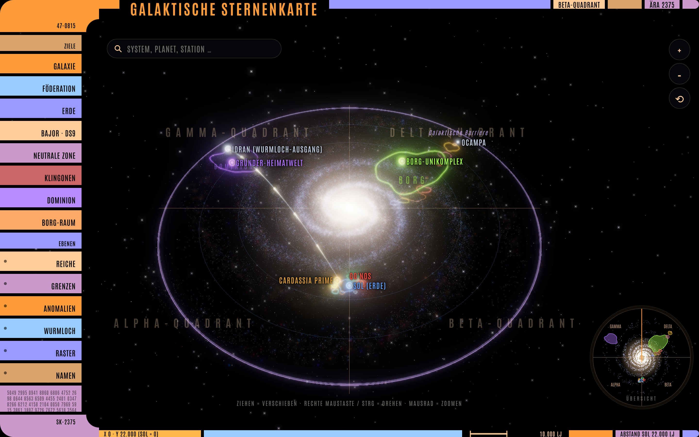
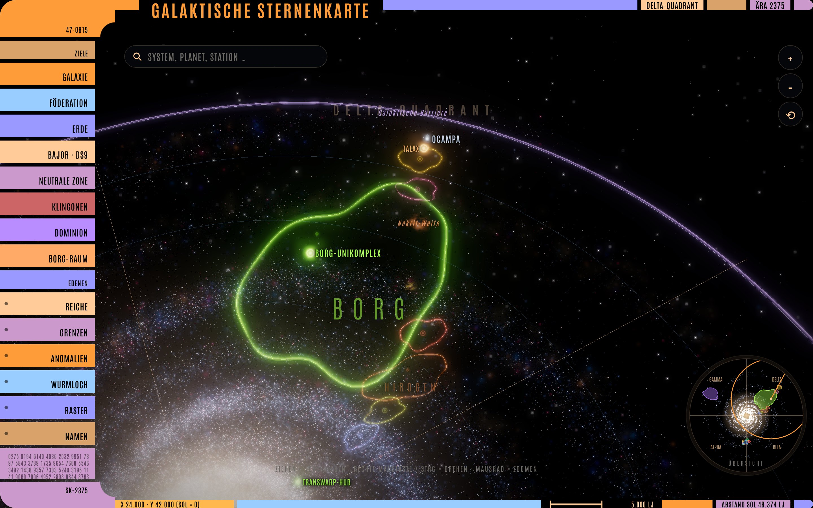

<div align="center">


# Galaktische Sternenkarte

Die Milchstraße aus Star Trek als 3D-Karte zum Drehen, Zoomen und Nachschlagen.
Mit Quadranten, Großmächten, Grenzen und Schauplätzen aus den Serien und Filmen.

[](https://jannickspielt.github.io/Star-Trek-Intergalactic-Map/)
[](https://threejs.org)
[](#als-app-installieren)
[](LICENSE)

<br>



</div>

## Was drin ist

Die Galaxie besteht aus rund 300.000 Sternen in vier Spiralarmen, mit Balken, Staubbändern und leuchtenden Nebeln. Man kann von der ganzen Milchstraße bis zu den Nachbarsternen der Erde hineinzoomen und die Ansicht frei drehen und kippen.

Eingezeichnet sind 20 Reiche, von der Föderation, den Klingonen und Romulanern bis zum Dominion im Gamma- und den Borg im Delta-Quadranten. Dazu kommen die Romulanische Neutrale Zone, die Entmilitarisierte Zone an der cardassianischen Grenze und die Grenze zum Klingonischen Reich.

70 Orte lassen sich anklicken. Das Infofenster zeigt einen kurzen Text, die Serien und Filme, in denen der Ort vorkommt, Quadrant, Entfernung zur Erde und ein Planetenbild, das der Browser selbst berechnet. Ein Link führt zu Memory Alpha.

Anomalien wie die Badlands, der Mutara-Nebel, die Delphische Ausdehnung und das Briar Patch erscheinen als farbige Wolken. Die Große Barriere umschließt den Kern, die Galaktische Barriere den Rand. Das Bajoranische Wurmloch spannt sich als leuchtender Bogen von Deep Space 9 bis in den Gamma-Quadranten.

Die Suche kennt auch andere Schreibweisen: „Kronos“ findet Qo'noS, „Terok Nor“ findet Deep Space 9. In der Seitenleiste gibt es Schnellziele und Schalter für die einzelnen Ebenen, unten rechts eine Übersichtskarte.

Auf dem Handy funktionieren Ziehen, Pinch-Zoom und Drehen mit zwei Fingern, das Infofenster fährt von unten herein. Die Seite lässt sich als App installieren und läuft nach dem ersten Besuch auch ohne Internet.

<table>
<tr>
<td width="62%"></td>
<td width="38%"></td>
</tr>
<tr>
<td></td>
<td></td>
</tr>
</table>

## Bedienung

| Aktion | Maus | Touch |
|---|---|---|
| Verschieben | Linke Maustaste ziehen | Ein Finger ziehen |
| Zoomen | Mausrad, Doppelklick, `+` / `−` | Zwei Finger auseinander oder zusammen |
| Drehen und kippen | Rechte Maustaste ziehen (oder `Strg` + ziehen) | Zwei Finger drehen oder gemeinsam hoch und runter schieben |
| Ort auswählen | Klick auf die Markierung | Antippen |
| Suchen | `/` drücken oder ins Suchfeld klicken | Suchfeld antippen |
| Auswahl schließen | `Esc` | Infofenster nach unten wischen |

## Lokal starten

Es gibt keinen Build-Schritt. Weil die Seite JavaScript-Module lädt, braucht sie aber einen kleinen lokalen Webserver:

```bash
npm run serve
```

Danach <http://localhost:8080> öffnen. Ohne npm geht es auch mit `python3 -m http.server 8080`.

## Auf GitHub Pages veröffentlichen

1. Im Repository Settings → Pages öffnen.
2. Bei Source „Deploy from a branch“ wählen, dann den Branch und den Ordner `/ (root)`.
3. Speichern. Nach etwa einer Minute ist die Karte unter `https://<benutzername>.github.io/Star-Trek-Intergalactic-Map/` erreichbar.

## Als App installieren

- Android mit Chrome: Menü ⋮ → App installieren
- iPhone mit Safari: Teilen → Zum Home-Bildschirm
- Desktop mit Chrome oder Edge: das Installieren-Symbol rechts in der Adressleiste

## Projektaufbau

```
index.html            Seitengerüst, Import-Map für three.js
css/style.css         gesamte Gestaltung (LCARS-inspiriert)
js/data/              Orte, Reiche, Regionen, Grenzen, Schnellziele
js/core/              reine Logik: Koordinaten, Suche, Beschriftung, Kamera
js/render/            3D: Galaxie, Reiche & Anomalien, Marker, Planetenbilder
js/ui/                Oberfläche: Rahmen, Infofenster, Suche, Übersichtskarte, Intro
icons/                App-Logo und Icons
sw.js                 Service Worker für Offline-Betrieb
tests/                Unit-Tests (node:test) und Browser-Tests (Playwright)
```

Neue Orte kommen in `js/data/places.js`. Jeder Eintrag braucht Position, Fraktion, Typ, eine Wichtigkeit von 1 bis 4, einen Kurztext, die Serien und einen Bildstil. Fehlt etwas, schlagen die Tests an.

## Tests

```bash
npm test        # Logik und Daten
npm run e2e     # Browser-Tests: Desktop, Handy, ohne WebGL, offline
```

## Was noch kommt

- Etappe 2: Voyagers Heimreise mit Abspielmodus, Filter nach Serie, Entfernungsmesser mit Warp-Reisezeiten, Links auf einzelne Orte
- Etappe 3: Grenzen je Jahrhundert, weitere Schiffsreisen, Favoriten, Hintergrundklang

## Hinweise

Das hier ist ein inoffizielles Fanprojekt ohne kommerzielle Absicht. Star Trek und die zugehörigen Namen sind Marken von CBS Studios und Paramount, mit denen dieses Projekt nichts zu tun hat.

Texte, Planetenbilder, Logo und Oberfläche sind selbst gemacht. Bilder oder Grafiken aus Serien und Filmen werden nicht verwendet.

Eine offizielle, widerspruchsfreie Sternenkarte gibt es im Canon nicht. Die Positionen folgen den Angaben aus Serien und Filmen, sind aber zugunsten der Lesbarkeit angenähert. Die Karte zeigt den Stand um 2375, am Ende des Dominion-Kriegs.
